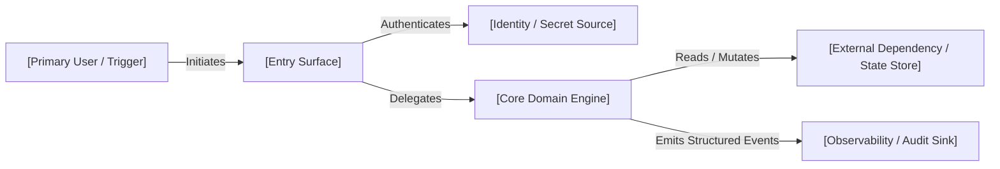
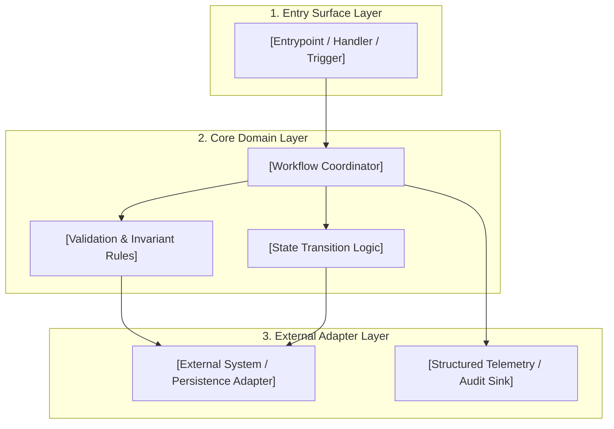
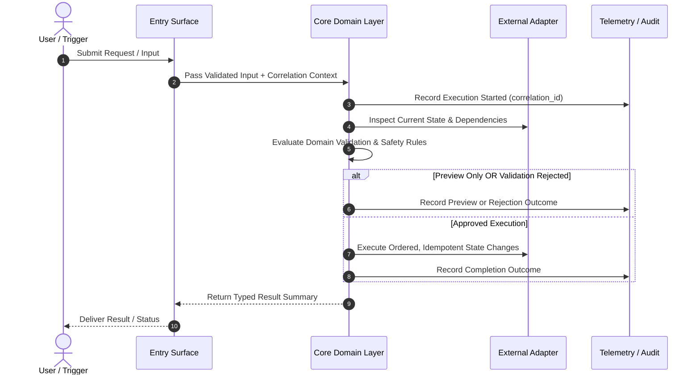

# Architecture Overview: [System Name]

| Metadata | Value |
| :--- | :--- |
| **System** | `[project-slug]` |
| **Architectural Pattern** | [Selected Structural Style Fitting Problem & Scale] |
| **Selected Technology Stack** | [Runtime, Language, Core Frameworks & Tooling Selected for This System] |
| **External Boundaries** | [Identity/Secret Stores, Data Stores, Target Systems, Telemetry Sinks] |

---

## 1. System Context

[1 concise paragraph describing where the system runs, who or what interacts with it, and which external systems sit across its boundaries.]

---

## 2. Selected Platform & Technology Stack

| Layer | Selected Technology | Version / Standard | Architectural Role |
| :--- | :--- | :--- | :--- |
| **Execution Environment** | [Selected Host / Platform] | [Version] | [Where the system runs] |
| **Language & Runtime** | [Selected Language / Runtime] | **[Version+]** | [Core execution foundation] |
| **Core Libraries / Frameworks** | [Selected Libraries / SDKs] | [Version] | [Application or domain tooling] |
| **State / Persistence** | [Selected Storage or Stateless Model] | [Version] | [How state is held or coordinated] |
| **Identity & Secrets** | [Selected Auth / Secret Mechanism] | [Standard] | [Credential & access boundary] |
| **Verification Tooling** | [Selected Native Test Runner] | [Version] | [Automated unit & integration verification] |

---

## 3. Component Boundaries & Separation of Concerns

To keep invocation glue decoupled from domain rules and external I/O side effects, the system enforces three distinct boundaries:

1. **Entry Surface Layer:** [Handles external input binding, authentication context, orchestration entry, and caller/user presentation—contains zero domain rules.]
2. **Core Domain Layer:** [Pure business workflows, invariants, readiness gates, and state transitions operating on typed contracts—completely free of direct external side effects.]
3. **External Adapter Layer:** [Thin, replaceable boundary isolating persistence, external SDKs, network calls, and system side effects so core logic can be verified offline.]

---

## 4. Primary Execution Sequence

---

## 5. Security, Identity & Secret Boundary

- **Authentication & Least Privilege:** [How callers/services authenticate and what authorization boundaries apply.]
- **Secret Lifecycle:** [How credentials or tokens remain protected in memory/secret stores and never persist in plaintext files or process arguments.]
- **Telemetry Sanitization:** [How sensitive credentials, tokens, or private data are automatically scrubbed before logging.]

---

## 6. Reliability, Ordering & Idempotency Strategy

### Validation & Fail-Safe Policy
[Core invariants verified prior to state mutation, including fail-closed behavior when required upstream information is missing or uncertain.]

### Execution Ordering & Concurrency Physics
[How operations are ordered, phased, or synchronized to prevent race conditions, deadlocks, or cascading instability.]

### Idempotency & Safe Re-Execution
[How retries or repeated runs inspect existing state first so interrupted or duplicate executions converge safely without duplicate side effects.]

---

## 7. Observability & Operational Telemetry

- **Correlation & Structured Format:** [Structured event format and end-to-end correlation identifier propagation.]
- **Delivery Resilience:** [How audit/operational events are recorded reliably without fragile coupling to monitoring downtime.]
